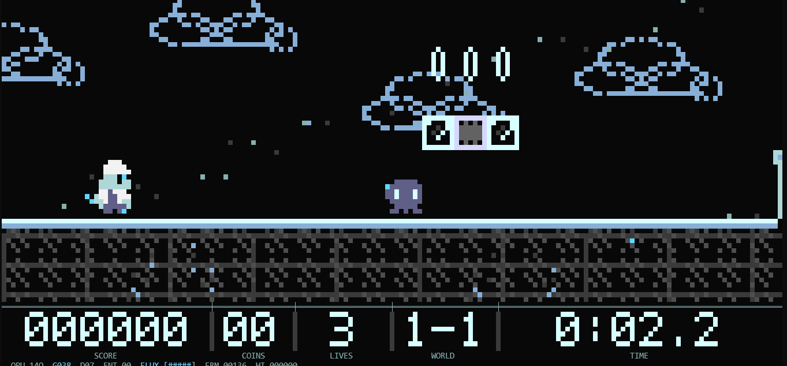

# QuantoMario

A terminal-based, Quandoom-inspired quantum platformer. Run, jump, stomp
enemies, and finish five worlds while a real 14-qubit state vector is prepared,
evolved, and measured alongside the game loop.



QuantoMario uses the monochrome x-ray instrument-panel look of Quandoom as its
default visual language, with an optional classic color mode. The platformer
physics are deliberately classical; the quantum register drives contextual
game outcomes, enemy behavior, and visual decoherence.

## Features

- Five complete side-scrolling worlds with checkpoints and a final boss.
- Story mode with three lives, scoring, level clear bonuses, and local top-five records.
- Speedrun mode with in-game time (IGT), deaths, splits, infinite retries, and a
  separate top-five leaderboard.
- A real 14-qubit state-vector simulation on every gameplay step: 16,384 complex
  amplitudes, a ~40-gate circuit, and one measurement per frame.
- Adaptive ANSI interface that responds to live terminal resizing.
- X-ray monochrome rendering by default; `C` toggles the classic color palette.
- In-game quantum lab with gate diagram, measured bits, marginals, 96-shot
  histogram, and OpenQASM export.
- No curses dependency. Rendering is based on ANSI half-block cells.

## Requirements

- Python 3.10 or newer (tested with Python 3.12).
- NumPy 1.24 or newer.
- A POSIX terminal: macOS, Linux, BSD, or Windows via WSL.
- A terminal at least **40 columns x 16 rows**. **80x24 or larger is recommended.**
- ANSI color support. Truecolor is used when available; 256-color and 16-color
  fallbacks are included.

## Install and run

```sh
cd quantum-mario
python3 -m venv .venv
. .venv/bin/activate
python3 -m pip install -r requirements.txt
./play.py
```

Or run the launcher directly:

```sh
python3 play.py
```

The game needs an interactive TTY. For a quick check without a terminal UI:

```sh
python3 play.py --demo --demo-size 120x40
python3 play.py --demo --demo-size 80x24 --no-ansi
```

## Controls

| Key | Action |
| --- | --- |
| `A` / `D` or Left / Right | Move |
| `W` / `Space` / Up | Jump |
| `S` / Down | Drop through one-way platforms / fast-fall |
| `E` | Quantum dash (costs 40 flux; temporarily phases enemies) |
| `X` | Toggle sprint during play; export `frame.qasm` in the quantum lab |
| `P` / `Esc` | Pause / back |
| `G` | Open the quantum lab |
| `H` | Observer manual during play; panel help inside the quantum lab |
| `C` | Toggle x-ray / classic rendering |
| `M` | Silent-mode joke (this terminal build has no audio) |
| `Q` | Quit from the title screen; quit to title from the pause menu |
| `Enter` | Confirm, advance, or submit initials |
| `Backspace` | Delete a character while entering initials |
| Up / Down | Navigate menus and the pause menu |

Terminal input is press-only: most terminals do not report key releases.
Movement therefore uses a short input-memory window refreshed by key
auto-repeat, while jumping is edge-triggered. See
[Terminal input notes](#terminal-input-notes).

## Modes

### Story mode

- Three lives.
- Checkpoints restore a safe position after a collapse.
- Score comes from coins, enemies, blocks, and level-clear bonuses.
- A top-five score qualifies you to enter three initials.
- Falling into a pit, touching a hazard, or colliding with an enemy can cost a
  life; losing all lives ends the run.

### Speedrun mode

- Five worlds, one continuous in-game clock, infinite retries.
- The timer starts when the intro ends and freezes when the level is cleared.
- Deaths are counted; a retry restarts the current level at its start.
- Pause > Restart Level also restarts the current level without stopping the
  clock.
- Finishing all five worlds qualifies for the speedrun top five if the time is
  fast enough.
- Splits and death count are saved with a qualifying run.

## Worlds

| World | Name | Par time |
| --- | --- | --- |
| 1-1 | Superposition Plains | 95s |
| 1-2 | Entanglement Caverns | 110s |
| 1-3 | Tunneling Skyway | 120s |
| 1-4 | Decoherence Foundry | 130s |
| 1-5 | The Observable | 140s |

World 1-5 ends with a three-phase boss. Defeating each phase opens the final
gate; reach the flag to finish the run.

## Quantum lab

Open the lab with `G` from play or from the pause menu, or choose QUANTUM LAB on
the title screen. Inside the lab, press `H` for the panel help.

The lab is a **read-only snapshot**, not a live simulation loop. While it is
open, gameplay is paused and the oracle does not tick, so the frame counter,
measured bits, histogram, and gate diagram remain frozen. The lab shows the last
frame that was simulated. From the pause menu that is the latest gameplay frame;
from the title screen it is a one-frame demo.

### Reading the display

- **Gate rows `q0..q13`**: the last seven layers of the frame circuit.
- **`M` column**: the measured 0/1 value of each qubit from the last shot.
- **Marginal P(1)**: the probability that each selected qubit measures as 1.
- **Entropy histogram**: 96 shots sampled from the last measured probability
  distribution for the four entropy qubits.
- **`SAMPLE`**: NumPy state-vector execution time for the displayed frame.
- **`GATES` / `DEPTH`**: size and depth of the displayed circuit.

### Lab keys

| Key | Action |
| --- | --- |
| `H` | Show lab help |
| `X` | Export the current frame to `frame.qasm` in the current working directory |
| `C` | Toggle x-ray / classic rendering |
| `G` / `Esc` / `Enter` | Leave the lab and return to play or the title screen |

The generated `frame.qasm` is an OpenQASM 2.0 description of the displayed
frame, ending in `measure q -> c;`. It is a circuit description, not a recorded
run of a hardware quantum computer.

## Quantum scope

The simulator is a genuine complex state-vector simulation, not a random-number
generator with quantum terminology attached. Each of the 14 qubits has a defined
role:

| Qubits | Role |
| --- | --- |
| 0-4 | Input preparation: left, right, jump, sprint, dash |
| 5-7 | Phase register coupled to movement and input |
| 8-11 | Entropy register, prepared in superposition |
| 12 | Reward / question-block measurement |
| 13 | Echo / afterimage flag |

Every gameplay step:

1. Inputs and game state prepare the register.
2. A circuit of roughly 40 gates is applied.
3. The full state vector is evolved.
4. The register is measured.
5. Measured bits feed game outcomes and presentation.

The measured values influence enemy moods, question-block rewards, coin luck,
ghost trails, and decoherence effects. They do **not** make Mario's gravity,
collision response, or platformer physics quantum. QuantoMario is a game with a
real quantum simulation embedded in it, not a quantum-physics platformer engine.

## Records and persistence

Records are stored as JSON at the first applicable location:

1. `--records PATH`, if supplied.
2. `$QUANTOMARIO_HOME/records.json`, if `QUANTOMARIO_HOME` is set.
3. `$XDG_DATA_HOME/quantomario/records.json`, if `XDG_DATA_HOME` is set.
4. `~/.local/share/quantomario/records.json`.

The game displays the top five story scores and top five speedruns, while
retaining up to 20 entries of each in storage. The selected x-ray/classic render
mode is saved alongside them. Writes are atomic: a temporary file is written and
then moved into place.

Story scores are ranked by score. Speedruns are ranked by finished IGT. If a run
does not qualify for the top five, it is shown on the results screen but is not
added to the record table.

## CLI reference

```text
python3 play.py [options]
```

| Option | Description |
| --- | --- |
| `--seed N` | Use a deterministic run seed |
| `--color MODE` | `auto`, `truecolor`, `256`, or `16` |
| `--fps N` | Render frame rate, clamped to 10-60 |
| `--classic` | Start in classic color mode |
| `--xray` | Start in Quandoom-style x-ray mode |
| `--records PATH` | Use a specific records JSON file |
| `--demo` | Render one demo frame and exit |
| `--demo-level N` | Demo world index, 0-4 |
| `--demo-steps N` | Advance the demo simulation by N steps |
| `--demo-size COLSxROWS` | Demo render size, for example `120x40` |
| `--no-ansi` | With `--demo`, print plain cell glyphs |
| `--dump-qasm PATH` | Write one frame circuit as OpenQASM and exit |
| `--levels` | List worlds and exit |
| `--selftest` | Run the non-interactive self-tests |
| `--help` | Show command-line help |

Useful non-interactive checks:

```sh
python3 play.py --levels
python3 play.py --selftest
python3 play.py --dump-qasm /tmp/frame.qasm
python3 play.py --demo --demo-size 40x16 --no-ansi
```

## Terminal and display notes

- The interface uses ANSI half-block cells (`▀`, `▄`, `█`) and bitmap text
  overlays, which keeps the game readable without a graphical toolkit.
- The layout is recalculated every rendered frame. Resize the terminal while
  playing; the HUD and world view adapt immediately.
- Below 40x16, the game shows a resize screen instead of a broken layout.
- The compact HUD is used on smaller terminals. A larger seven-row instrument
  HUD appears at 112x32 and above.
- Rendering defaults to x-ray mode. Press `C` to switch to classic colors; the
  choice is persisted in the records file.
- There is no audio.

## Terminal input notes

Terminals generally send key presses, not key releases. QuantoMario therefore:

- remembers a direction for a short window while key auto-repeat refreshes it;
- uses edge-triggered jumping with a small jump buffer and coyote time;
- preserves air momentum so jumps do not depend on perfect key-repeat timing.

For the smoothest experience, set a short keyboard repeat delay in your terminal
or desktop keyboard settings. A very long initial repeat delay can make held
movement pause briefly before auto-repeat starts.

## Project layout

```text
play.py                 Executable launcher
requirements.txt        NumPy dependency
quantomario/
  app.py                Application state machine, menus, pause, lab routing
  game.py               Player physics, enemies, boss, checkpoints, scoring
  levels.py             Five world definitions and map parsing
  quantum.py            14-qubit state-vector simulator, circuit, oracle, QASM
  input.py              Raw terminal input and movement memory
  render.py             Pixel/cell canvases, ANSI encoding, terminal setup
  screens.py            Title, records, controls, lab, menus, results
  view.py               World rendering, HUDs, responsive layout
  entities.py           Player, enemies, controls, platform, run state
  scores.py             Local top-five records and time formatting
  sprites.py            Code-defined pixel sprites
  theme.py              X-ray luminance mapping and classic palettes
  fonts.py              Bitmap type used by the pixel canvas
  main.py               CLI, demos, QASM export, self-tests
```

## Development checks

```sh
python3 -m py_compile quantomario/*.py
python3 play.py --selftest
python3 play.py --demo --demo-size 120x40
```

The self-test covers the Bell-pair state-vector check, oracle output and QASM,
sprite validity, all five level maps, responsive render sizes, physics smoke
tests, and time formatting.

## Known limitations

- Terminal key-release behavior is not standardized; see
  [Terminal input notes](#terminal-input-notes).
- Leaderboards are local. There is no online submission.
- Terminal color rendering varies. The 16-color fallback approximates the
  palette more aggressively than truecolor or 256-color terminals.
- The lab is intentionally a paused inspection screen. It does not animate new
  circuits until you return to gameplay and reopen it.
- Quantum simulation cost grows exponentially if the qubit count is increased;
  14 qubits is a deliberate playable limit.

## Disclaimer

QuantoMario is an unofficial fan project. It is not affiliated with or endorsed
by Nintendo. Super Mario and related names are trademarks of Nintendo. The
included graphics are code-defined original pixel art; no Nintendo asset files
are bundled.

The project is inspired by Quandoom's quantum frame-loop concept and monochrome
x-ray presentation. Quandoom and QuandoomEngine remain the work of their
respective authors and are not bundled with this project.
